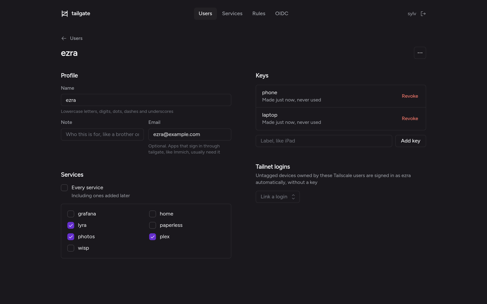
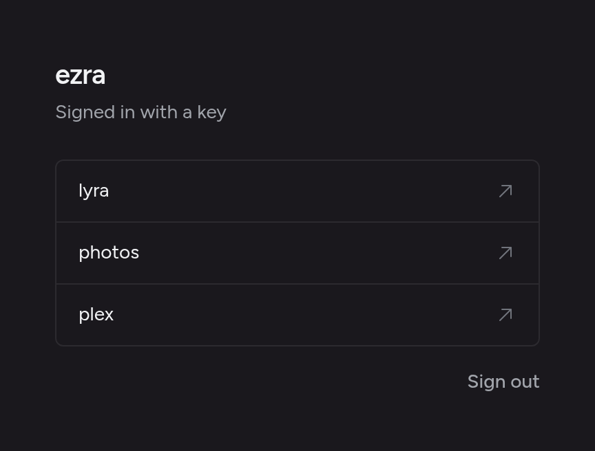
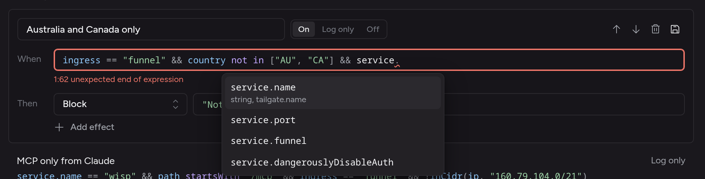

# tailgate

tailgate is a reverse proxy hooked into tailscale. Stick `tailgate.id=photos` and `tailgate.port=2283` on a container and its available at `https://photos.your-tailnet.ts.net` over your tailnet by default, or publicly by setting `tailgate.funnel=true` via [tailscale funnel](https://tailscale.com/docs/features/tailscale-funnel)

Funnel users who aren't on your tailnet sign in with a key, or taillscale users accessing tailgate services over your tailnet can login automatically once an admin links their tailscale login to a tailgate user. Rules let you apply redirects, block requests, forward headers upstream, and a lot more. an OIDC provider lets supported apps sign people in with the same auth tailgate uses.

**the tl;dr** is I wanted Cloudflare Tunnel and Cloudflare Access, but using tailscale. so thats what this is - it replaces my previous cloudflare tunnel (for public access) + traefik (for internal access) with a single proxy that can handle auth and tailnet/public requests.

<sup>AI was used heavily to make tailgate, you can decide how that affects your choice.</sup>

<sup>funnel only serves traffic with a nodes own name, so tailgate runs a node for each service. that means each will show up as its own device in your tailscale admin console which kinda sucks. until [tailscale services](https://tailscale.com/kb/1552/tailscale-services) adds support for funnels, this is the simplest path.</sup>

<table>
  <tr>
    <td></td>
    <td></td>
  </tr>
</table>

## Features

- Every container gets its own `*.ts.net` name and HTTPS cert
- Auth sits in front of each service, or can be disabled for services that handle it on their own
- Service accesss is decided per user
- Tailscale users can be tied to tailgate users, letting them bypass signing in for requests from their devices
- Keys in request headers for scripts, mobile apps and MCP clients
- Custom rules that let you block, redirect, skip, or add and remove headers by various expressions
- An OIDC provider for supported services (Immich, Grafana, etc) so users only need one tailgate login to access multiple services
- Works with tailnet lock

## Setup

### 0. tailscale

tailgate's nodes all carry `tag:tailgate`. add this to your tailnet policy so they work as expected:

```jsonc
{
  "tagOwners": { "tag:tailgate": ["autogroup:admin"] }, // create the tailgate tag
  "nodeAttrs": [{ "target": ["tag:tailgate"], "attr": ["funnel"] }], // allow tailscale funnel access to tailgates nodes
  "grants": [{ "src": ["autogroup:member"], "dst": ["tag:tailgate"], "ip": ["443"] }], // let tailnet members talk to tailgate nodes
  // you may want to ensure tailgate nodes cannot talk to other nodes in your network
}
```

once that is done:

1. MagicDNS and HTTPS certificates have to be on
2. create a reusable auth key tagged `tag:tailgate` and pass it as `TS_AUTHKEY`


for tailnet lock, you can sign the key once with `tailscale lock sign <key>` on a signing device. that will cause any node tailgate creates to automatically be signed.

### 1A. with the docker proxy

for security, it is *strongly recommended* to use the tailgate docker proxy, which helps isolate root access if tailgate ever had a vulnerability.

```yaml
services:
  tailgate-docker:
    container_name: tailgate-docker
    image: ghcr.io/sylv/tailgate:v1
    command: ["docker-proxy"]
    user: "0"
    network_mode: none
    restart: unless-stopped
    volumes:
      - /var/run/docker.sock:/var/run/docker.sock
      - tailgate-docker:/run/tailgate

  tailgate:
    # on initial start, you'll want to "mkdir -p ./.tailgate && sudo chown -R 65532:65532 ./.tailgate"
    # or else the directory permissions won't allow tailgate to write to the data directory.
    # or just use docker volumes instead of a host mount. whatever
    container_name: tailgate
    image: ghcr.io/sylv/tailgate:v1
    restart: unless-stopped
    depends_on:
      - tailgate-docker
    environment:
      - TS_AUTHKEY=tskey-auth-...
      - TZ=Australia/Sydney # optional, for now() in rules and log timestamps. default = UTC
      - DOCKER_HOST=unix:///run/tailgate/docker.sock
    volumes:
      - tailgate-docker:/run/tailgate
      - ./.tailgate:/data

volumes:
  tailgate-docker:
```

### 1B. as root

if you want a simpler setup, you can run tailgate as root and pass the docker socket in directly. you probably shouldn't, but its a free country.

```yaml
services:
  tailgate:
    image: ghcr.io/sylv/tailgate:v1
    user: "0"
    restart: unless-stopped
    environment:
      - TS_AUTHKEY=tskey-auth-...
      - TZ=Australia/Sydney # optional, for now() in rules and log timestamps. default = UTC
    volumes:
      - /var/run/docker.sock:/var/run/docker.sock
      - ./.tailgate:/data
```

Either way tailgate has to share a network with the containers it proxies to, or run with `network_mode: host`. Back up the data volume, it has the users, keys and every node's state

### 2. first start

tailgate logs a setup link like `https://tailgate.your-tailnet.ts.net/setup?key=...`. open it from a device on your tailnet, pick the admin's name and save the key it gives you. until then no services start and funnel stays off, and each restart logs a new setup link. if tailscale names the node `tailgate-1` because the name is taken, tailgate waits and logs what to rename, same as for services. the admin page is at `https://tailgate.your-tailnet.ts.net/admin` and is not accessible outside of the tailnet.

```sh
# if you ever lose a key, reset it like this. it revokes all of that user's keys (signing them out everywhere) and prints one new key.
docker exec tailgate tailgate reset-key <user>
# if you need to make someone an admin, or change the admin, use this
docker exec tailgate tailgate set-admin <user> true|false
```

## usage

### exposing a container

```yaml
services:
  immich:
    image: ghcr.io/immich-app/immich-server
    labels:
      # what tailgate keeps this service's user access, rules, OIDC clients and node state under. don't change it
      - tailgate.id=photos # required
      # the node's name on your tailnet, so its address. change it any time, the node keeps its state and device.
      # if another device has the name, tailscale calls the node photos-1 and it waits, with an error on the admin page,
      # until you free the name and rename it back in the tailscale admin console
      - tailgate.hostname=pics # default = tailgate.id
      # the port tailgate connects to wihin the container
      - tailgate.port=2283 # required
      # whether to make this app publicly accessible. if true, the node will enable tailscale funnel.
      # otherwise, only users on your tailnet can access it.
      - tailgate.funnel=true # default = false
      # if the app itself has auth or you like living on the edge, you can disable tailgates auth.
      # for something like homeassistant which handles its own auth and does not support OIDC without extensions, you'll likely want this.
      - tailgate.dangerouslyDisableAuth=true # default = false
      # by default tailgate asks search engines not to index the app with an X-Robots-Tag header.
      # set this to false for something you want showing up in search results, like a public blog.
      # tailgate's own pages are never indexed
      - tailgate.noindex=false # default = true
      # the network tailgate reaches the container on, like traefik.docker.network. tailgate has to be on it too.
      # if the container isn't on it, the service won't start and the admin page lists the networks it is on.
      - tailgate.network=sylv_proxy # default = TAILGATE_NETWORK, or the container's first network by name
```

tailgate connects to the container's IP on `tailgate.network`, then `TAILGATE_NETWORK`, then the container's first network sorted by name, so tailgate has to be on that network too. containers with `network_mode: container:...` or `service:...` are reached through the container they borrow the network from, which can set `tailgate.network` itself, and `network_mode: host` ones through the Docker bridge's gateway

if you delete a service's device in the tailscale admin console or its key expires, the service stops and waits for you to press "Log in again" on the services page, so it doesn't come back on its own. the tailgate node logs back in by itself

### users and keys

admins add users and tick the services each one can reach (or just all services). a new user gets a key to send them. they sign in with it on the login page, which shows the services they can use

<table>
  <tr>
    <td></td>
    <td></td>
  </tr>
</table>


<details>
<summary>A user's page</summary>

</details>

link a tailnet login like `you@github` to a user and that logins devices are signed in as them, no key needed. tagged devices, subnet routers and exit nodes never sign anyone in as they speak for more than one person.

apps and scripts can send a key with each request instead:

- `Authorization: Bearer tg_...`, which also works for MCP clients like Claude
- `X-Tailgate-Key: tg_...`, for apps that already use `Authorization`, like the Immich mobile app's custom headers

tailgate strips its keys and cookie before the request reaches the app

### rules

rules run on every request to a service, top to bottom. Each one has an [expr](https://expr-lang.org/docs/language-definition) condition and effects like `block`, `redirect`, `skip`, and setting or removing request and response headers. rules before the login see every request, and rules after it know who the user is

Over Funnel, rules before the login also run on tailgate's own pages, like the login page, where `service.id` is `""`. On the tailnet they don't, so a bad rule can't lock you out of the admin page. The admin page isn't on Funnel at all

Every service and tailgate itself answer `/.tailgate/trace` with what tailgate sees of your request, like cloudflare's `/cdn-cgi/trace`: your IP, country, ingress, how you're signed in and the request id. It runs before the rules, so it works even when they block you

```
before login  ingress == "funnel" && country not in ["AU", "CA"]                                   block
before login  service.id == "wisp" && path startsWith "/mcp" && !inCidr(ip, "160.79.104.0/21")  block
after login   service.id == "lyra"                                                                set-request-header X-User = user.name
```


the editor autocompletes every value and function, and checks each rule as you type



country info uses [DB-IP](https://db-ip.com)

### OIDC

OIDC can be used so that upstream services use tailgate for auth instead of implementing their own. This requires:
- The upstream service to support [OIDC](https://openid.net/developers/how-connect-works/)
- The Tailgate user to have an email set
- The Tailgate user to have access to the service

generally setup will vary by app. create an OIDC profile for the app, then configure the app to talk to tailgate. it varies by app. good luck! :) 


the apps server has to reach the tailgate node to swap codes for tokens, so the server's tailnet device needs a grant to `tag:tailgate` on port 443.

### env variables

| Variable             | Default                       |                                                                                |
| -------------------- | ----------------------------- | ------------------------------------------------------------------------------ |
| `TS_AUTHKEY`         | required                      | A reusable auth key tagged `tag:tailgate`                                      |
| `TAILGATE_HOSTNAME`  | `tailgate`                    | The name of the node with the login page, admin pages and OIDC                 |
| `TAILGATE_DATA_DIR`  | `/data`                       | The database, every node's state and the country database                      |
| `DOCKER_HOST`        | `unix:///var/run/docker.sock` | Where Docker is, as `unix://` or `tcp://`                                      |
| `TAILGATE_NETWORK`   |                               | The network to reach containers on when they don't set `tailgate.network`      |
| `TZ`                 | `UTC`                         | The time zone for `now()` in rules and log timestamps                          |
| `TAILGATE_LOG_JSON`  | `false`                       | Log JSON instead of coloured text                                              |
| `TAILGATE_LOG_LEVEL` | `info`                        | `debug` also shows tailscale's own logs for each node, for connection problems |
| `NO_COLOR`           |                               | Set to anything to log text without colour                                     |
